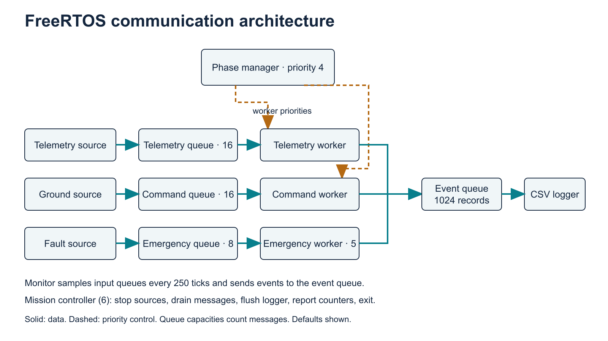
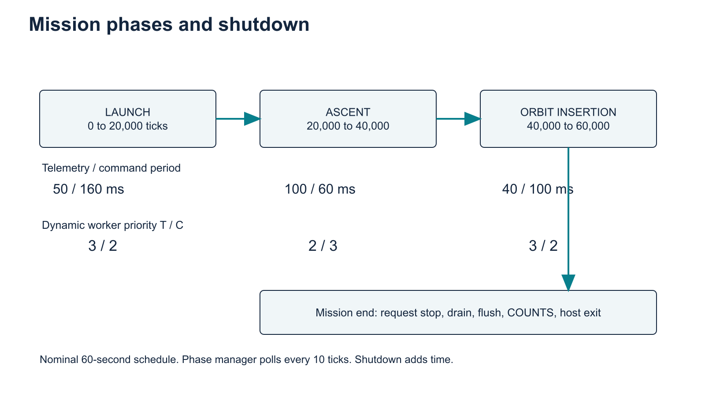

# High-level design

Spacecraft Communication Scheduling Across Mission Phases Using FreeRTOS

Review edition, 15 November 2026. Implementation: `src/main.c`. This document describes the implemented host simulator.

## 1. Purpose and boundary

The simulator asks how mission-dependent task priorities affect message processing during launch, ascent and orbit insertion. It uses the actual FreeRTOS kernel and its POSIX port. Telemetry, ground commands and emergency events are synthetic messages inside one process. There is no radio protocol, flight dynamics model, physical spacecraft interface or ground-network transport.

The validated execution platform is Ubuntu 22.04 on GitHub Actions. macOS is the development and analysis platform. The repository deliberately rejects native Apple builds in CMake; this is a project configuration decision, not a claim that all FreeRTOS POSIX versions lack Apple-specific support.

## 2. Functional architecture

Three source tasks send value-copied `Message` objects to three independent FIFO queues. Each queue has one consumer. Telemetry and command consumers perform synthetic CPU work. Emergency handling records receipt without a comparable CPU workload. Sources never wait for queue space: a full queue increments a drop counter.

The phase manager changes a shared atomic phase and adjusts telemetry and command worker priorities. Sources select their next delay using the phase observed when they create a message. A queued message retains its creation phase even if the mission advances before completion.

A queue monitor samples all three input queues every 250 nominal milliseconds. Workers, the phase manager and the monitor send `Event` objects to a bounded event queue. The logger is the single normal stdout writer and exports CSV. The mission controller stops production, allows a wakeup interval, drains queues and reports independent final counters to stderr.

## 3. Mission lifecycle

For a 60-second mission, nominal phase boundaries occur at ticks 20,000 and 40,000. The manager polls every 10 ticks, so the observed boundary can be later. A phase update is not a simultaneous transaction across all tasks: the phase store and the two priority changes are separate operations.

At tick 60,000 the controller requests producer shutdown. Shutdown takes additional scheduler time. The default emergency interval adds a 3,100-tick grace period before worker drain checks. The final mission event therefore occurs after the requested mission duration. The stop time is not a measured network outage.

## 4. Scheduling policy

| Policy | Launch T/C | Ascent T/C | Orbit insertion T/C |
|---|---|---|---|
| Dynamic | 3 / 2 | 2 / 3 | 3 / 2 |
| Static | 3 / 2 | 3 / 2 | 3 / 2 |
| Equal | 2 / 2 | 2 / 2 | 2 / 2 |
| Inverted | 1 / 4 | 1 / 4 | 1 / 4 |

Higher numeric priority runs first among ready tasks. Preemption and equal-priority time slicing are enabled. The term inverted names a deliberately unfavorable priority assignment for telemetry. It is not a mutex-based priority-inversion experiment.

Emergency worker priority is always 5. Mission controller is 6. Phase manager is 4. All sources are 2. Logger and monitor are 1. Producer priorities therefore matter when consumers consume a large fraction of CPU time.

## 5. Interfaces and assumptions

| Interface | Contract |
|---|---|
| CLI | Validated numeric bounds and one of four policy names |
| Message queues | FIFO, value copy, nonblocking send, bounded capacity |
| Event queue | Nonblocking instrumentation, loss counted independently |
| CSV stdout | Header followed by eight fields per event |
| stderr | Final accepted/completed/dropped counts and queue depths |
| Analyzer | Per-run, per-creation-phase and per-channel summaries |
| Evidence validator | Counter reconciliation, lifecycle and deadline consistency |

Tick frequency is nominally 1 kHz. The implementation uses relative `vTaskDelay`, so actual source release intervals include processing and scheduling delay. Latency measures message creation to worker completion in kernel ticks. It is neither release jitter nor radio latency. A value of zero means no tick boundary occurred between the two samples.

## 6. Resource and failure strategy

The application requests ten tasks with 2,048 stack units each, plus kernel resources. Heap configuration is 1 MiB using heap_4. Input queues contain 16 telemetry messages by default, 16 command messages and 8 emergency messages. Telemetry capacity can be 1 through 256. Event capacity is 1,024.

Queue or task allocation failure stops the program. Assertion, malloc-failure and stack-overflow hooks abort. Full input queues drop new messages. A full event queue drops instrumentation and makes the trace unsuitable for complete latency analysis. Shutdown uses bounded waiting and host process exit. It is suitable for a host experiment, not a device power-down procedure.

## 7. Design tradeoffs and limitations

Separate queues protect emergency traffic from a telemetry FIFO backlog. The high emergency priority favors response after an emergency has been generated. It does not prove a fault injector can run on time, since its priority is 2. The synthetic injector also represents periodic faults rather than random hardware failures.

The event logger avoids ordinary concurrent stdout access. POSIX host scheduling and library calls still affect timing. There is no hardware WCET, CPU-utilization trace, stack-watermark measurement or formal response-time proof in this package. Queue depth is sampled and observed after operations, not continuously tracked as an exact high-water mark.

Original workload multipliers produce little contention on the tested host. Supplementary `--service-us` experiments add per-thread CPU demand and preserve the original default workload. Their results must remain separate from E1-E9.

## 8. Traceability

The technical report links the measurements to the research questions. The low-level design gives function-level contracts and shutdown details. `TEST_EVIDENCE.md` identifies executed checks and limitations. `EXPERIMENTS.md` defines both experiment suites. The team roster is Esonov Sunnatbek Saydulla Ugli (202412372), Singla Vaidant (202608452) and Rajbhandari Kusum (202512310). Individual contributions and the original assignment rubric remain unverified.
