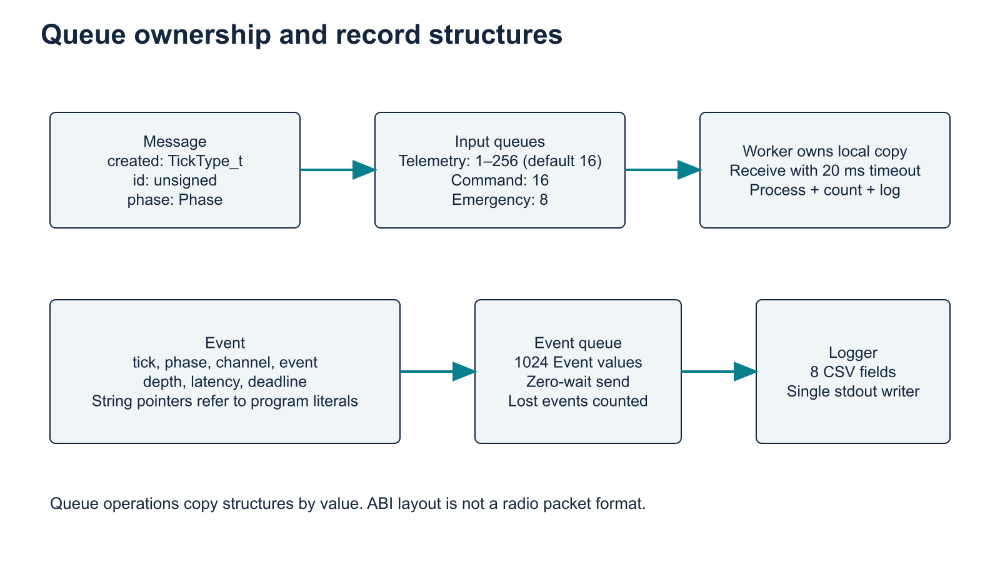

# Low-level design

Implemented C application and analysis pipeline. Review edition, 15 November 2026.

## 1. Source organization

| File | Responsibility |
|---|---|
| `src/main.c` | CLI parsing, all task bodies, queue allocation, phase changes and shutdown |
| `include/FreeRTOSConfig.h` | Tick, heap, priorities, hooks and enabled APIs |
| `CMakeLists.txt` | C11 application, GCC_POSIX port, heap_4 and pinned kernel tag |
| `scripts/analyze.py` | Percentiles, counts, sampled queue depth and miss percentages |
| `scripts/validate_evidence.py` | Lifecycle and independent counter reconciliation |
| `scripts/run_matrix.py` | E1-E9 commands, repetitions, raw traces and manifests |
| `scripts/run_contention.py` | C1-C6 CPU-demand experiments, three repetitions |
| `scripts/check_cli.py` | Twelve rejected argument cases against the real executable |

## 2. Data model and ownership

`Phase` has LAUNCH, ASCENT and ORBIT_INSERTION. `Policy` has DYNAMIC, STATIC, EQUAL and INVERTED.

`Message` contains `TickType_t created`, unsigned `id` and `Phase phase`. Sources create a stack-local message. FreeRTOS copies its value into the input queue and then into the worker's local variable. No task shares a pointer to a source stack object. ID increases independently per source but is not exported into the CSV, so per-message sequence auditing cannot be reconstructed from the trace.

`Event` contains a relative tick, phase, two constant string pointers for channel/event name, and unsigned depth, latency and deadline. String pointers refer to string literals with program lifetime. The event queue copies the record, not the literal contents. Byte sizes depend on the target ABI and must not be inferred from a packed network format.

Queue handles and two worker task handles are process-wide. Phase and shutdown flags use C11 atomics. Accepted, completed and dropped counters use atomic unsigned values. Immutable CLI options are initialized before scheduler startup.

## 3. Tasks

| Task | Priority | Blocking or pacing | Main operation |
|---|---|---|---|
| TelemetryWorker | Policy, initially 3 | Receive up to 20 ms | Work, deadline check, log |
| CommandWorker | Policy, initially 2 | Receive up to 20 ms | Work, deadline check, log |
| EmergencyWorker | 5 | Receive up to 20 ms | Count and log handling |
| PhaseManager | 4 | Delay 10 ms | Phase polling and priority update |
| TelemetrySource | 2 | Delay 50/100/40 ms | Nonblocking telemetry send |
| GroundSource | 2 | Delay 160/60/100 ms | Nonblocking command send |
| FaultSource | 2 | Delay 100-3000 ms | Inject after delay, recheck stop |
| QueueMonitor | 1 | Delay 250 ms | Sample all three queues |
| Logger | 1 | Receive up to 20 ms | Serialize CSV stdout |
| MissionEnd | 6 | Mission delay and drain delays | Stop, drain, report, exit |

All explicit task creations request 2,048 stack units. Task creation order ensures the telemetry and command worker handles exist before `managePhase` can adjust them. The kernel idle task is additional to these ten application tasks.

## 4. Task algorithms

Telemetry and command sources repeat: read phase, timestamp and increment source ID, attempt zero-wait queue send, increment accepted counter on success or drop counter on failure, log a drop if needed, then delay by the period associated with the captured phase. These are periodic-intent relative delays, not an absolute-release schedule. A producer may be delayed by a higher-priority ready worker before it can generate its next message.

Workers repeat while shutdown is not requested or their input queue is nonempty. They receive with a 20-tick timeout, perform work, subtract the creation tick from the current tick, count completion and log one outcome. The telemetry loop performs 2,000 times stress integer iterations in launch/ascent and 4,000 times stress in orbit insertion. Command work performs 2,000 times stress iterations.

Optional `service(multiplier)` adds a CPU-time budget. It repeatedly reads `CLOCK_THREAD_CPUTIME_ID` after small loop chunks until elapsed thread CPU nanoseconds reach `serviceUs * multiplier * 1000`. Telemetry multiplier is 2 in orbit insertion and 1 otherwise. Command multiplier is 1. Default `serviceUs=0` returns immediately. This budget includes work and clock-read overhead inside the loop, may overshoot by a chunk, and does not calibrate emergency work or the kernel. It is a host experiment feature.

Emergency handling uses no synthetic work budget. It measures delay between actual message generation and completion, not time from a scheduled fault release. A slow fault source can reduce injection count without raising emergency latency.

## 5. Phase and policy operations

`managePhase` uses elapsed ticks from an epoch captured before scheduler startup. For duration D seconds it uses integer millisecond thirds `D*1000/3`. It stores a new phase atomically, logs a transition and calls `setPolicy`. `setPolicy` calls `vTaskPrioritySet` for telemetry and then command. Each operation can affect scheduling immediately. It then emits `priority_update`, encoding telemetry priority in the latency field and command priority in the deadline field. These control rows must never be included in latency statistics.

Initial priority update occurs in LAUNCH without a transition event. Normal transitions must be ASCENT then ORBIT_INSERTION. The evidence validator checks this sequence. It does not prove the two priority changes were atomic or that no task executed between them.

## 6. Deadlines and measurement

| Channel | Deadline ticks | On-time condition | Logged success |
|---|---|---|---|
| Telemetry | 100 | elapsed <= 100 | completed |
| Command | 80 | elapsed <= 80 | completed |
| Emergency | 20 | elapsed <= 20 | handled |

`elapsed > deadline` emits `deadline_miss`. A miss still counts as a processed message. Equality meets the deadline. The phase attached to completion is the message's creation phase, while the event tick is its completion timestamp.

Monitor rows use channel `monitor` and events `telemetry_depth`, `command_depth` and `emergency_depth`. The corrected analyzer maps these observations into their corresponding channels before calculating maximum observed depth. Worker depth observations follow removal/processing. Neither source is an exact instantaneous maximum.

## 7. Shutdown sequence

1. MissionEnd wakes after the requested duration and sets `stopProducers=1`.
2. It waits `emergencyInterval+100` ticks so delayed sources can observe the flag.
3. It waits up to 1,500 ticks while any input queue is nonempty, yielding every 20 ticks.
4. It sets `stopWorkers=1` and waits 200 ticks. A worker may still finish an in-flight message.
5. It emits one mission-finished event and gives the event queue up to 2,000 ticks to drain.
6. It sets `stopLogger=1`, waits 100 ticks, prints COUNTS, flushes stderr and calls host `exit(0)`.

A queue can be empty while a worker has an in-flight message. Fixed grace periods do not formally join tasks. Therefore zero process exit alone is inadequate: accepted counts must equal completed counts, logger loss must be zero, queue depths must be zero and CSV totals must reconcile. The validator enforces these observed completion conditions and rejects failures. A rejected run requires investigation or a longer shutdown strategy before using it in a report.

## 8. CLI and failure contracts

| Option | Accepted values |
|---|---|
| `--policy` | dynamic, static, equal, inverted |
| `--duration` | 9-3600 seconds |
| `--stress` | 1-1000 |
| `--service-us` | 0-1000000 microseconds of added CPU demand |
| `--telemetry-queue` | 1-256 messages |
| `--emergency-interval` | 100-3000 ms |
| `--run-id` | 1-47 ASCII letters, digits, underscores or hyphens |

Invalid or incomplete options return 2. Allocation/creation or CPU-clock failures terminate. An unexpected return from scheduler startup returns 3. Runtime hooks report and abort. The code does not provide a recovery task or persistent fault log.

## 9. Analysis contracts

The analyzer groups by run ID, phase and channel. Processed events are completed, handled or deadline_miss. Drops are separate and excluded from latency samples. Median and p95 use linear interpolation at index `(n-1)*p` and round to three decimal places. Miss percentage is 100 times misses divided by processed messages. Empty latency groups have blank latency values.

The evidence validator requires eight CSV columns, known phase names, nonnegative numeric values, one run ID, exactly one finished event, the expected transition sequence, no early finish, exactly one final COUNTS record, zero logger loss and zero remaining queues. For each channel it reconciles processed and drop CSV counts with stderr, accepted with processed, requires nonzero processing and checks deadline labels.

The validator is a trace-consistency check. Because the simulator does not export attempts or message IDs, it cannot independently detect an omitted source attempt or prove exact release timing.

## 10. Configuration and extension points

The kernel tag is V11.1.0, resolved commit `dbf70559b27d39c1fdb68dfb9a32140b6a6777a0`. The application links the real kernel, POSIX port, heap_4, pthreads and libm. It enables preemption, time slicing, seven priorities, stack/malloc hooks and dynamic allocation. Software timers are disabled.

Future improvements include absolute periodic release with overrun counters, per-message IDs in CSV, enqueue/dequeue high-water counters, acknowledged task shutdown and interrupt-origin emergency injection. These are extensions, not features claimed by the present implementation.
