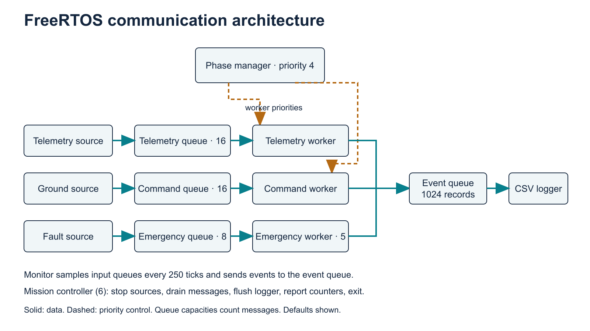
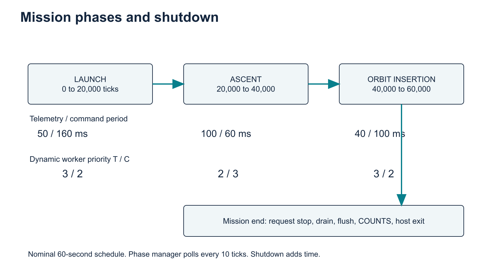

# Technical report

Spacecraft Communication Scheduling Across Mission Phases Using FreeRTOS

Review edition: 15 November 2026

| Team member | Student ID |
|---|---|
| Esonov Sunnatbek Saydulla Ugli | 202412372 |
| Singla Vaidant | 202608452 |
| Rajbhandari Kusum | 202512310 |

Repository: https://github.com/sunnatbek06/FreeRTOSproject

Review: https://github.com/sunnatbek06/FreeRTOSproject/pull/1

Tested code: `1abe724835a4779390df2b0b9cc7e73e281a413e`

Notion: https://app.notion.com/p/4188c3a60ac581cb90f6cc8691c96392

## Abstract

This project implements a spacecraft-inspired communication workload with real FreeRTOS tasks, queues, preemptive priorities and phase-dependent parameters. It progresses through launch, ascent and orbit insertion and records latency, deadline misses, observed queue depth and drops. An original 27-run matrix passed, followed by a revised 27-run suite after analysis improvements. The loop-only workload produced a pooled p95 of zero nominal ticks in every scenario/channel and did not resolve scheduling differences. An added 18-run CPU-demand suite exposed telemetry congestion under equal and inverted priorities and command misses under static priorities. Dynamic priorities avoided measured misses in these cases but delayed sources and reduced generated traffic. These descriptive host results support further scheduling investigation, not a physical real-time guarantee.

## 1. Objectives and scope

Mission communication demands change over time. Launch favors frequent telemetry, ascent increases ground-command frequency and orbit insertion increases telemetry frequency and processing demand. The project investigates whether adapting priorities improves responsiveness, how workload and queue capacity affect congestion, and whether emergency handling stays responsive.

The measured system is one host process containing the actual FreeRTOS kernel and synthetic sources. It includes no radio propagation, packet framing, retransmission, flight dynamics or physical ground station. The Python analysis consumes real traces; it does not emulate a scheduler or generate experimental observations.

## 2. Architecture

Three source/queue/worker pipelines share an event logger. Telemetry and command workers perform synthetic CPU work. Emergency handling uses a separate queue and priority-5 worker. A priority-4 phase manager updates worker priorities. A priority-6 controller stops production, drains queues and reports independent final counters. Sources are priority 2; logger and monitor are priority 1.

Input capacities are telemetry 16 by default, command 16 and emergency 8. The event queue holds 1,024 records. Telemetry capacity is configurable. Queues copy structures by value. Input sends never wait for space; accepted messages and drops are counted independently. The normal stdout writer is the logger.

FreeRTOS V11.1.0 resolves to commit `dbf70559b27d39c1fdb68dfb9a32140b6a6777a0`. CMake builds its POSIX port and heap_4. Configuration enables preemption, time slicing, a nominal 1 kHz tick, seven priorities and a 1 MiB heap. The application creates ten tasks with 2,048 stack units each. These allocations are configuration values, not measured peak usage.

| Phase | Telemetry period | Command period | Dynamic T / C priority |
|---|---|---|---|
| Launch | 50 ms | 160 ms | 3 / 2 |
| Ascent | 100 ms | 60 ms | 2 / 3 |
| Orbit insertion | 40 ms | 100 ms | 3 / 2 |

Static priorities stay 3/2, equal stay 2/2, and inverted stay 1/4. Inverted names an unfavorable telemetry policy, not mutex priority inversion. Phase polling occurs every 10 ticks. Phase storage and both priority changes are separate operations, not an atomic transaction.

## 3. Measurement definitions

Latency is completion tick minus creation tick. Deadlines are telemetry 100, command 80 and emergency 20 ticks. Equality meets the deadline. A miss still counts as processed. Zero ticks means the observations fall within one tick, not zero physical execution time. Completion rows retain the message's creation phase.

The monitor samples queues every 250 ticks; workers also observe depth after processing. The corrected analyzer attributes monitor samples to the correct channel. Maximum depth means maximum observed depth, not a continuously measured high-water mark.

Sources use relative delays. Actual release intervals include scheduling delay, so high-priority workers can prevent a source from generating its next message. Emergency latency begins at actual injection and excludes fault-source release delay. Processing counts and drops therefore accompany every latency comparison.

Median and p95 use linear interpolation at sorted index `(n-1)*p`. Pooled percentiles are recomputed from raw samples rather than averaged from per-run p95 values. Run and phase tables remain available in `evidence/analysis/`. No statistical-significance claim treats thousands of messages as independent policy repetitions.

## 4. Experiment protocol

The original E1-E9 matrix uses 60-second missions and three repetitions. E1 is dynamic baseline; E2 static; E3 equal; E4 inverted; E5 telemetry capacity 2; E6 loop stress 10; E7 loop stress 50; E8 periodic 100-ms emergencies; E9 repeats baseline parameters. The labels heavy load and emergency burst do not establish saturation or simultaneous burst packets.

The first 27 runs executed sequentially on one virtual runner on 13 November. The tested-source rerun on 15 November Korea time uses three isolated repetition jobs, each running all nine scenarios sequentially. Within-repetition cases share a runner; between-repetition hosts can differ. Environment files preserve CPU, compiler, source/config/binary digests and the kernel commit.

After the original workload showed too little contention, optional `--service-us` added measured thread CPU demand. C1-C5 add a 40,000-us base budget per telemetry/command message, doubling telemetry demand during orbit insertion. C6 uses 20,000 us. All use 15-second missions, three repetitions and a 100-ms emergency interval. C1-C4 compare policies, C5 reduces telemetry capacity to 2 and C6 reduces demand. All 18 run on one virtual runner in repetition-major order, separately from E1-E9.

The CPU budget is a lower-bound target checked between work chunks and may overshoot. CPU time and nominal kernel ticks use different clocks. A 40,000-us demand can appear as fewer than 40 ticks if the host tick thread runs slower than nominal. No calibrated physical-millisecond accuracy is inferred.

## 5. Revised full-matrix results

All 27 revised runs completed. Every scenario/channel has p95 zero ticks, with zero input drops and deadline misses. Only E7 telemetry has maximum latency one tick. E4 telemetry has maximum observed depth one; all other observed depths are zero. Each scenario processes 3,300 telemetry messages and 1,977 commands across its repetitions. Emergency totals are 57 except E8, which processes 1,797.

| Case | Channel | N | p95 ticks | Max | Misses | Drops |
|---|---|---|---|---|---|---|
| E1_dynamic_baseline | command | 1977 | 0.0 | 0 | 0 | 0 |
| E1_dynamic_baseline | emergency | 57 | 0.0 | 0 | 0 | 0 |
| E1_dynamic_baseline | telemetry | 3300 | 0.0 | 0 | 0 | 0 |
| E2_static | command | 1977 | 0.0 | 0 | 0 | 0 |
| E2_static | emergency | 57 | 0.0 | 0 | 0 | 0 |
| E2_static | telemetry | 3300 | 0.0 | 0 | 0 | 0 |
| E3_equal | command | 1977 | 0.0 | 0 | 0 | 0 |
| E3_equal | emergency | 57 | 0.0 | 0 | 0 | 0 |
| E3_equal | telemetry | 3300 | 0.0 | 0 | 0 | 0 |
| E4_inverted | command | 1977 | 0.0 | 0 | 0 | 0 |
| E4_inverted | emergency | 57 | 0.0 | 0 | 0 | 0 |
| E4_inverted | telemetry | 3300 | 0.0 | 0 | 0 | 0 |
| E5_small_queue | command | 1977 | 0.0 | 0 | 0 | 0 |
| E5_small_queue | emergency | 57 | 0.0 | 0 | 0 | 0 |
| E5_small_queue | telemetry | 3300 | 0.0 | 0 | 0 | 0 |
| E6_moderate_stress | command | 1977 | 0.0 | 0 | 0 | 0 |
| E6_moderate_stress | emergency | 57 | 0.0 | 0 | 0 | 0 |
| E6_moderate_stress | telemetry | 3300 | 0.0 | 0 | 0 | 0 |
| E7_heavy_stress | command | 1977 | 0.0 | 0 | 0 | 0 |
| E7_heavy_stress | emergency | 57 | 0.0 | 0 | 0 | 0 |
| E7_heavy_stress | telemetry | 3300 | 0.0 | 1 | 0 | 0 |
| E8_emergency_burst | command | 1977 | 0.0 | 0 | 0 | 0 |
| E8_emergency_burst | emergency | 1797 | 0.0 | 0 | 0 | 0 |
| E8_emergency_burst | telemetry | 3300 | 0.0 | 0 | 0 | 0 |
| E9_transition_repeat | command | 1977 | 0.0 | 0 | 0 | 0 |
| E9_transition_repeat | emergency | 57 | 0.0 | 0 | 0 | 0 |
| E9_transition_repeat | telemetry | 3300 | 0.0 | 0 | 0 | 0 |

These outcomes validate execution, transitions and evidence capture at this workload. They do not establish adaptive-policy superiority. E5 never fills its small queue; E7 creates no material deadline pressure. The older November 13 suite is retained separately, including its small timing/count differences.

## 6. Supplementary contention results

| Case | Channel | N | p95 ticks | Max | Misses | Drops |
|---|---|---|---|---|---|---|
| C1_dynamic | command | 369 | 38.0 | 38 | 0 | 0 |
| C1_dynamic | emergency | 414 | 0.0 | 0 | 0 | 0 |
| C1_dynamic | telemetry | 453 | 75.0 | 75 | 0 | 0 |
| C2_static | command | 435 | 130.3 | 146 | 48 | 0 |
| C2_static | emergency | 375 | 0.0 | 0 | 0 | 0 |
| C2_static | telemetry | 414 | 75.0 | 75 | 0 | 0 |
| C3_equal | command | 489 | 86.0 | 101 | 48 | 0 |
| C3_equal | emergency | 441 | 0.0 | 1 | 0 | 0 |
| C3_equal | telemetry | 621 | 2054.0 | 2068 | 171 | 196 |
| C4_inverted | command | 339 | 37.0 | 37 | 0 | 0 |
| C4_inverted | emergency | 405 | 0.0 | 0 | 0 | 0 |
| C4_inverted | telemetry | 630 | 1751.0 | 1780 | 192 | 137 |
| C5_small_queue | command | 369 | 38.0 | 38 | 0 | 0 |
| C5_small_queue | emergency | 414 | 0.0 | 1 | 0 | 0 |
| C5_small_queue | telemetry | 453 | 75.0 | 76 | 0 | 0 |
| C6_lower_demand | command | 414 | 56.0 | 57 | 0 | 0 |
| C6_lower_demand | emergency | 417 | 0.0 | 1 | 0 | 0 |
| C6_lower_demand | telemetry | 559 | 37.0 | 38 | 0 | 0 |

Equal priorities (C3) produce 196 telemetry drops, 171 telemetry misses and telemetry p95 of 2,054 ticks. Inverted priorities (C4) produce 137 telemetry drops, 192 misses and p95 1,751 ticks. Both reach an observed telemetry depth of 16. Static priorities (C2) avoid telemetry misses but cause 48 command misses and command p95 130.3 ticks, beyond the 80-tick deadline.

Dynamic priorities (C1) produce no measured misses/drops, with telemetry/command p95 75/38 ticks. However, C1 completes only 453 telemetry messages and 369 commands, compared with C3's 621 and 489 completions plus C3's telemetry drops. Higher-priority consumers delay priority-2 producers before message creation. Offered traffic is therefore not equivalent fixed-rate input. Low latency alone cannot establish general superiority.

Small capacity under dynamic priorities (C5) does not change completion counts or produce drops. Its observed backlog stays zero, so it cannot establish a general capacity recommendation. Lower CPU demand (C6) produces 559 telemetry completions, no misses/drops and telemetry p95 37 ticks. Command p95 is 56 ticks, still within its deadline. Demand changes interleaving as well as individual work time.

All contention scenarios have emergency maxima of zero or one tick, without emergency misses/drops. Emergency scenario totals range from 375 to 441 across repetitions. Variable injection counts reinforce that source scheduling delay lies outside the emergency latency metric.

### Run-level variability

| Case | Telemetry p95 range | Command p95 range | Telemetry N per run |
|---|---|---|---|
| C1_dynamic | 75-75 | 38-38 | 151-151 |
| C2_static | 75-75 | 129.6-131.6 | 138-138 |
| C3_equal | 2047.7-2056 | 77.9-87 | 207-207 |
| C4_inverted | 1742.4-1754.75 | 37-37 | 210-210 |
| C5_small_queue | 75-75 | 38-38 | 151-151 |
| C6_lower_demand | 37-37 | 56-56 | 186-187 |

Ranges describe three observed repetitions only. Fixed case order and shared virtual infrastructure limit statistical and causal interpretation.

## 7. Verification and corrections

The tested code passed Linux CMake Debug build, actual simulator smoke execution and twelve analyzer/evidence unit tests. Twelve invalid executable CLI cases returned the expected rejection. The 27 revised full runs and 18 contention runs completed. Independent local auditing also checked the first 27 traces, giving 72 preserved and validated runs.

The review corrected monitor-depth attribution and added independent counter reconciliation. The matrix runner now rejects incomplete evidence. It preserves the original protocol and adds separate CPU-demand cases because the loop multipliers did not resolve the research question. Documentation also now distinguishes the repository's deliberate Linux-only build restriction from upstream POSIX source, which contains untested Apple-specific paths.

Every archived trace has the correct phase sequence, one completion, no logger loss, empty final queues and accepted counts equal completed counts. CSV processed/drop totals match stderr. These observed conditions do not constitute formally acknowledged task termination. Shutdown still uses grace periods and host exit, so new workloads must pass the same checks.

## 8. Limitations and next work

The simulator lacks absolute periodic release, release-jitter counters, per-message exported IDs, continuously tracked queue peaks, measured stack/heap peaks, hardware faults and a formal response-time proof. Emergency processing has no comparable synthetic work budget. Host timing and variable offered traffic constrain conclusions. Native Mac simulator execution and target-hardware behavior were not tested.

Useful extensions are absolute releases with overrun counts, message IDs and attempted-release timestamps, queue high-water counters and acknowledged shutdown. A hardware implementation would need board-specific clocks, drivers and independent validation. These are future extensions, not completed features.

The team roster is user-provided. Individual contributions, historical Notion activity and original rubric compliance remain unverified. The newly created Notion home records present work and a confirmation checklist, without invented meetings or personal credit.

## 9. Conclusion

The project delivers an executable real-FreeRTOS host simulator, reproducible experiments, independently checked evidence and documented tradeoffs. The original matrix confirms execution under little contention. Added demand shows dynamic priorities preserve measured deadlines in these cases, with reduced source throughput. Equal and inverted priorities reveal telemetry congestion, while static priorities reveal command sensitivity. A defensible conclusion reports latency and generated traffic together and remains limited to this implementation and its virtual hosts.

## References and evidence

1. Tested project source: https://github.com/sunnatbek06/FreeRTOSproject/tree/1abe724835a4779390df2b0b9cc7e73e281a413e
2. Official POSIX port: https://github.com/FreeRTOS/FreeRTOS-Kernel/blob/V11.1.0/portable/ThirdParty/GCC/Posix/port.c
3. Official task implementation: https://github.com/FreeRTOS/FreeRTOS-Kernel/blob/V11.1.0/tasks.c
4. Revised matrix: https://github.com/sunnatbek06/FreeRTOSproject/actions/runs/43622890428
5. Contention suite: https://github.com/sunnatbek06/FreeRTOSproject/actions/runs/43622890473
6. Original matrix: https://github.com/sunnatbek06/FreeRTOSproject/actions/runs/43341653550
7. Raw archives, environments and hashes: `evidence/`. Run/phase/pooled tables: `evidence/analysis/`. Function-level design: `docs/LOW_LEVEL_DESIGN.md`. Reproduction: `docs/IMPLEMENTATION_GUIDE.md`.
